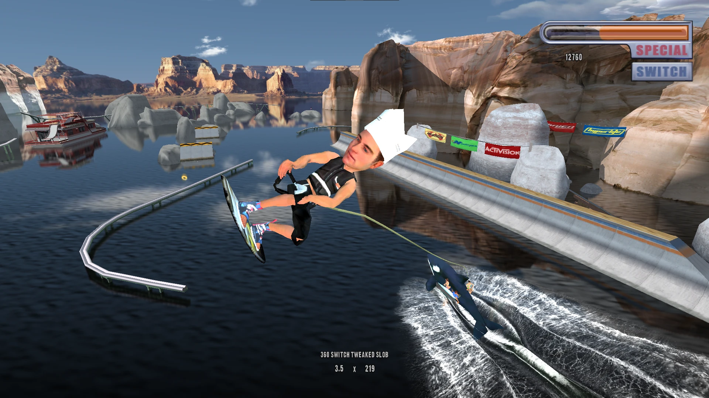
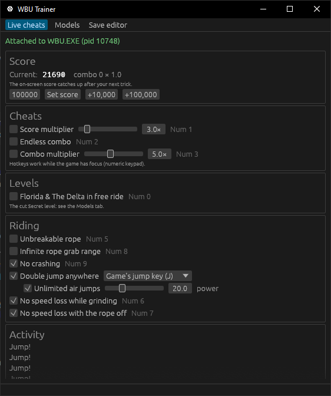
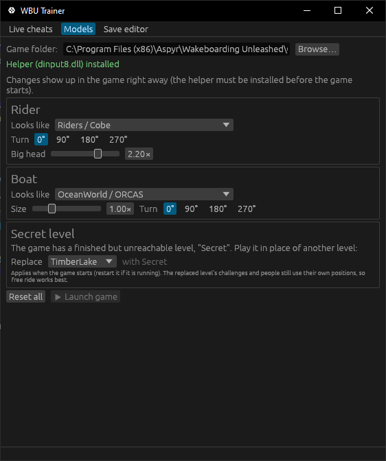
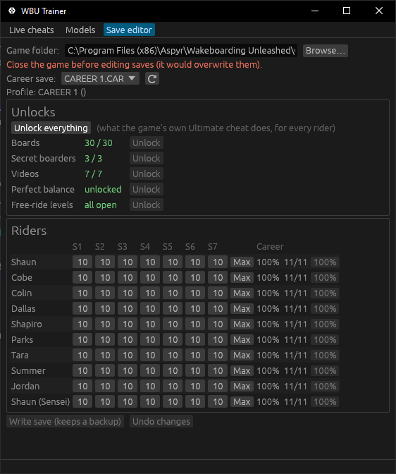

# WBU Trainer

A trainer for **Wakeboarding Unleashed featuring Shaun Murray** (PC, Aspyr, 2003): live cheats while you ride,
any model in the game as your rider or boat, and a career save editor that can unlock everything.

<p align="center">
  
  <br><em>Big heads and an orca for a boat at Lake Powell, in 1080p with the WBU widescreen fix.</em>
</p>

<p align="center">
  
  
  
</p>

## Features

### Live cheats
Applied to the running game; toggle them in the window or with the numeric keypad while you play.

| Cheat | Hotkey | What it does |
|---|---|---|
| Score multiplier (1–20×) | Num 1 | Every banked combo is worth N times the points |
| Endless combo | Num 2 | The combo timer never runs out |
| Combo multiplier (1–10×) | Num 3 | Holds the combo multiplier while a combo builds |
| +10,000 score | Num 4 | Also: set score, +100,000 |
| Unbreakable rope | Num 5 | The rope no longer snaps when it passes through objects; you can still drop it |
| No speed loss while grinding | Num 6 | Keep the speed you had when the grind started |
| No speed loss with the rope off | Num 7 | Keep your release speed until you grab the rope again |
| Infinite rope grab range | Num 8 | Call for the rope from anywhere and it catches (you're placed behind the boat) |
| No crashing | Num 9 | No falls, bails or wipeouts, so no respawn |
| Double jump anywhere | the game's jump key | Jump from anywhere on the water and again in mid-air, as often as you like (or once per airtime); adjustable power |
| Florida & The Delta in free ride | Num 0 | Free ride normally hides these two levels (career already lists them) |

### Models (live, while you play)
- **Your rider can look like any model in the game**: another rider, or anyone and anything from the levels
  (gators, the gondolier, a cow, orcas, a hazmat guy…). Non-rider models ride stiffly on the board, sized to fit.
- **Your boat can look like any model** too: the gondola, a jet ski, an orca…
- **Big heads**, rider size (for non-rider looks), boat size, and a turn control to face models the right way.
- **The cut Secret level**: the game ships a finished level called *Secret* that no menu can reach.
  Pick a level for it to replace and it loads in that level's place. Switch it on or off any time; it applies
  the next time you enter the level.

Changes show up in the game immediately. This needs the small in-game helper (`dinput8.dll`), installed with one click.

### Save editor
Edits `Game\Save\*.CAR` while the game is closed, with a backup before every write.
- **Unlock everything** in one click (what the game's own Ultimate cheat does, for every rider),
  or one at a time: all 30 boards, the 3 secret boarders, all videos, perfect balance, all free-ride levels.
- Per rider: the 7 stats (max 10) and **100% career** (every goal, challenge and gap done, every level beaten,
  so career levels and the credits level unlock).

### Also fixed
The helper fixes the game's *"realloc relocated memory block!"* crash when changing levels or quitting on modern Windows.

## Download and install
1. Download `wbu-trainer-1.2.2.zip` from the [Releases](../../releases) page and extract it anywhere.
2. Run `wbu-trainer.exe`. It finds the default install
   (`C:\Program Files (x86)\Aspyr\Wakeboarding Unleashed\Game`); otherwise browse to the folder with `WBU.EXE`.
3. For the Models tab, open it and click **Install** to copy `dinput8.dll` into the game folder
   (do this before starting the game). Live cheats and the save editor work without it.
4. Start the game, from the trainer or as usual, and keep the trainer open.

**Uninstall:** delete `dinput8.dll`, `wbu-trainer.ini` and `wbu-trainer.log` from the game folder.
The trainer itself installs nothing else.

### Notes
- Made for the Aspyr PC release (`WBU.EXE`). The trainer checks the build first and leaves other versions alone.
- Works alongside the WBU widescreen fix (`d3d8.dll`).
- Cheats that change the game's code (rope, grab range, no crashing, score multiplier) stay active until you
  switch them off or restart the game, even if the trainer is closed.
- The game folder is under Program Files: if installing the helper or saving settings fails, run the trainer
  as administrator once, or give your user write access to the game folder.
- Close the game before editing saves; the game would overwrite them.
- Windows may warn about an unsigned download. The source is all here, so you can build it yourself (below).

## Building from source
Requirements: Windows, [Rust](https://rustup.rs) (stable, MSVC toolchain), and the 32-bit target for the helper:

```powershell
rustup target add i686-pc-windows-msvc
```

Build everything and create the release zip:

```powershell
./package.ps1        # -> dist\wbu-trainer-<version>.zip (wbu-trainer.exe, dinput8.dll, README, LICENSE)
```

Or build the parts separately:

```powershell
cd trainer; cargo build --release     # 64-bit trainer window: target\release\wbu-trainer.exe
cd helper;  cargo build --release     # 32-bit helper (target set in .cargo\config.toml):
                                      #   target\i686-pc-windows-msvc\release\dinput8.dll
cd trainer; cargo test --release      # save-editor test (set WBU_TEST_SAVE to a career save to run it)
```

## Project layout
| Path | Contents |
|---|---|
| `trainer/` | The trainer window (Rust, [egui](https://github.com/emilk/egui)). Live cheats read and write the game's memory; save editor. |
| `helper/` | In-game helper, a `dinput8.dll` proxy (Rust, 32-bit): live model swaps, big heads, the crash fix. |

## How it works (short version)
- **Live cheats** attach to `WBU.EXE` and read/write its memory about 100 times a second. Some patch a few bytes
  of the game's code (each only over the exact original bytes, and restored when switched off). The score
  multiplier installs a tiny stub where the game banks a combo's points.
- **Models**: every model in the game is created by one function and drawn by one call. The helper hooks both,
  keeps a pristine copy of each mesh, rewrites vertex positions for big heads and sizes (the game skins on the
  CPU every frame), and builds replacement models on demand with the game's own loader. Non-rider models are
  bound rigidly to the wakeboard bone; rider-for-rider swaps map bones by position.
- **Save editor**: the career save is a fixed layout with no checksum; the unlock bits come from the game's own
  cheat code.

The addresses were found by reverse engineering `WBU.EXE`. No game files are included in this repository;
you need your own copy of the game.

## License
MIT, see [LICENSE](LICENSE).

Not affiliated with or endorsed by Activision, Shaba Games or Aspyr Media. *Wakeboarding Unleashed* is a
trademark of its respective owners.
